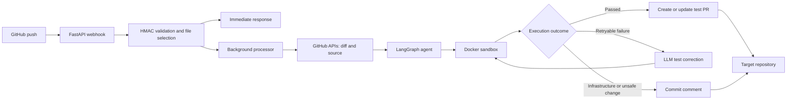

# TestAgent

TestAgent is an autonomous service that generates pytest tests for Python source files changed in a GitHub repository. It receives a signed GitHub push webhook, identifies the affected functions, generates tests with OpenAI, executes them in an isolated Docker sandbox, repairs retryable test failures, and opens a pull request containing only validated test changes.

The service does not change target source code. When a contract-correct test exposes a likely implementation defect, TestAgent reports the evidence in a commit comment instead of changing the assertion to make the test pass.

## How it works

1. GitHub sends a `push` webhook to `POST /webhook/github`.
2. The service verifies the HMAC signature, filters changed Python files outside `tests/`, and responds immediately.
3. A background task fetches the source and cumulative diff from GitHub.
4. The agent determines changed or deleted functions, reconciles the corresponding module test file, and generates targeted pytest blocks.
5. The complete merged test file runs in a disposable Docker sandbox.
6. A passing result becomes part of a pull request. Test failures can enter the correction loop; infrastructure failures and non-converged or unsafe changes become commit comments.

## Architecture



The main components are:

- **Webhook orchestration** validates deliveries, analyzes a push, and coordinates publication.
- **LangGraph agent** manages generation, sandbox execution, bounded correction, and final status.
- **Sandbox runner** executes untrusted generated code in a fresh, read-only Docker container with network, memory, CPU, and timeout limits.
- **Analysis and merge tools** map diffs to functions, preserve unrelated test content, reconcile deleted symbols, and merge generated test blocks.
- **GitHub client** reads source and diffs, creates branches and pull requests, and posts diagnostic commit comments.

## Project structure

```text
app/
├── main.py                     FastAPI application entry point
├── config.py                   Environment loading and runtime settings
├── agent/
│   ├── graph.py                LangGraph workflow definition
│   ├── nodes.py                Generation, execution, correction, and finalization nodes
│   ├── prompts.py              Whole-file and targeted prompt builders
│   └── state.py                Shared agent-state contract
├── tools/
│   ├── sandbox.py              Isolated Docker test execution
│   ├── github_client.py        GitHub Contents, Compare, PR, and comment operations
│   ├── code_parser.py          Diff and function analysis
│   ├── test_merger.py          Generated-test ownership, merge, and cleanup logic
│   └── pr_description.py       Deterministic pull-request metadata
└── webhooks/
    └── github_webhook.py       Signed GitHub push endpoint and orchestration

sandbox/                        Docker image definition and sandbox dependencies
scripts/run_local.py            Local demonstration entry point
tests/                          Fast unit tests and Docker-marked integration tests
conftest.py                     Test-time environment defaults
pytest.ini                      Pytest configuration and Docker marker
requirements.txt                Application and test dependencies
```

## Requirements

- Python 3.11 or later
- Docker Desktop or another working Docker runtime
- An OpenAI API key for generation
- A GitHub token for webhook-driven source reads and pull-request publication
- An HTTPS tunnel such as ngrok for live GitHub webhook testing from a local machine

## Setup

Create and activate a virtual environment, then install the project dependencies:

```bash
python3 -m venv venv
source venv/bin/activate
pip install -r requirements.txt
```

Create local environment configuration from the example and supply the required credentials:

```bash
cp .env.example .env
```

At minimum, set `OPENAI_API_KEY`. Webhook operation also needs `GITHUB_WEBHOOK_SECRET` and `GITHUB_TOKEN`. The token needs repository Contents read/write and Pull requests write permissions when TestAgent will publish results.

Build the sandbox image before any real agent or Docker integration run:

```bash
docker build -t test-agent-sandbox:latest sandbox/
```

## Run locally

Run the built-in example against the local generation and sandbox workflow:

```bash
source venv/bin/activate
python scripts/run_local.py
```

This command uses the example source in `scripts/run_local.py`. It requires a valid OpenAI key and the `test-agent-sandbox:latest` image.

## Run as a webhook service

Start the API server:

```bash
source venv/bin/activate
uvicorn app.main:app --reload --port 8000
```

In a separate terminal, expose the server:

```bash
ngrok http 8000
```

Set the forwarding URL in the target repository's GitHub webhook configuration with the `/webhook/github` path, then configure the same secret in `.env` as `GITHUB_WEBHOOK_SECRET`. Each eligible push receives an immediate acceptance response while generation and publication continue in the background.

Use a new push or update the webhook configuration to test connectivity after changing its secret. Redelivering an older event preserves its original signature.

## Run tests

Run the fast suite, which uses mocks and does not call external APIs or Docker:

```bash
pytest tests/ -m "not docker"
```

Run Docker integration tests after building the sandbox image:

```bash
pytest tests/ -m docker -v
```

Measure coverage for the agent package:

```bash
pytest tests/ -m "not docker" --cov=app/agent --cov-report=term-missing
```
